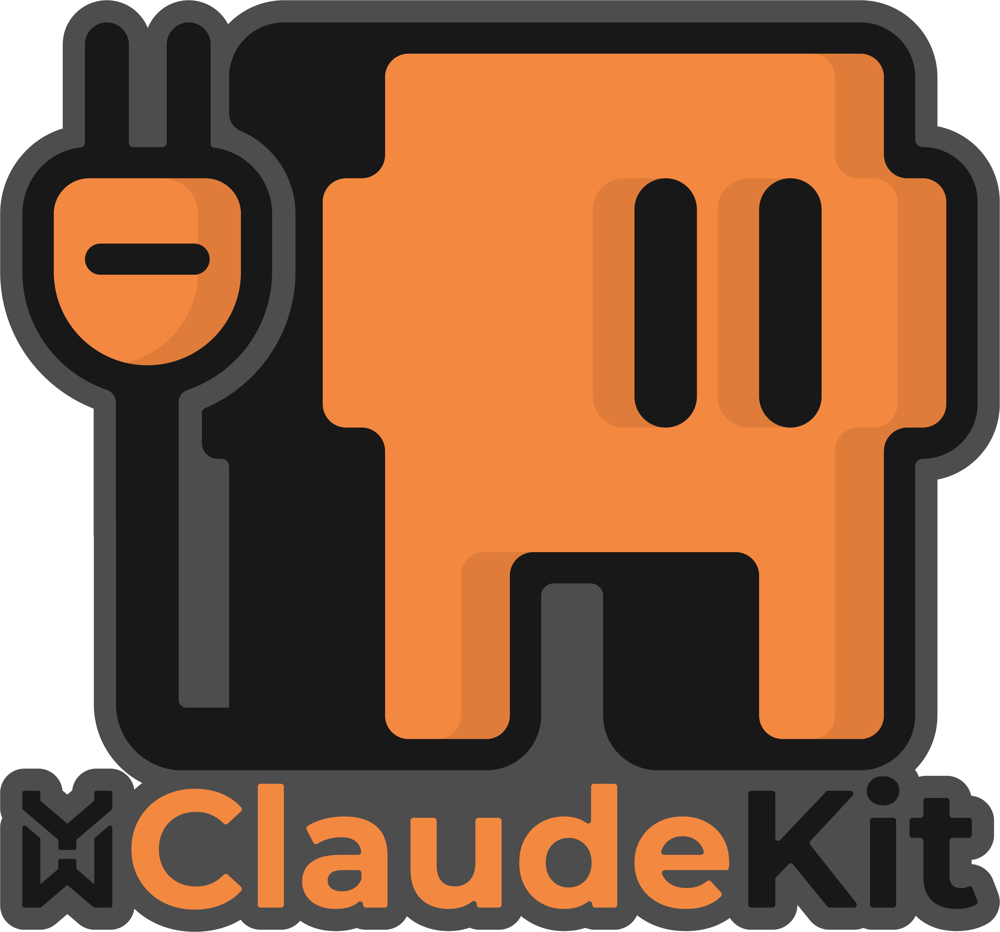

Build by *0xnhsec*

# *Credit*
https://github.com/yeswehack/claude-kit/

<p align="center">
  
</p>

<h1 align="center">opencode-YWH-kit</h1>

An OpenCode kit that makes YWH bughunting discipline **mandatory**:
one install gives the agent an always-on rules layer plus **four
skills** — a mandatory hunt orchestrator plus three specialists for
writing, triaging, and class-specific checks. Reports stay
triager-grade because the agent drafts, structures, and validates
**only from facts you provide** — real URLs, payloads, responses, and
observed behavior — and asks instead of guessing when something is
missing.

> Ported from
> [yeswehack/claude-kit](https://github.com/yeswehack/claude-kit).
> Behavior and report standards are identical; only the plumbing
> changed from Claude Code (`SessionStart` hook + `/ywh:` plugin) to
> OpenCode (`AGENTS.md` + `opencode.json` + `skill/` + auto-loaded
> plugin).

> **Full walkthrough:** [Triager-grade reports with Claude
> Code](https://www.yeswehack.com/fr/learn-bug-bounty/triager-grade-reports-claude-code)
> on YesWeHack (same report standard this kit enforces).

---

## What you get

**1. Always-on rules** — `AGENTS.md` is loaded by OpenCode at the
start of every session, and `.opencode/plugins/ywh-mandatory.ts`
re-injects the mandatory directive into the system prompt as a
backstop. Unverified claims are kept out from the first prompt:
never invent facts, never write theoretical impact, no OWASP
boilerplate, and out-of-scope / unprovable claims get flagged —
during investigation, drafting, and validation alike.

**2. Four skills** — advertised to the agent, loaded on demand via
the `skill` tool (loading `ywh-*` is pre-allowed in `opencode.json`,
so it never prompts):

| Skill | Invoke it for... | What it does |
|---|---|---|
| `ywh-bughunt` (**mandatory**) | any YWH work: "hunt this", "is this exploitable?", or just opening a YWH session | Loads FIRST, owns the pipeline: confirms scope/RoE, runs evidence-first investigation, routes drafting → `ywh-write` and finalization → `ywh-triage`. |
| `ywh-write` | "how should I structure this?", "help me write this up" | Shapes the draft into the required sections (aligned with YesWeHack guidance) with per-section format rules. Drafts from your facts, asks when one is missing. |
| `ywh-triage` | "is this ready to submit?", "triage this", "validate my draft" | Returns a verdict (READY TO SUBMIT / NEEDS FIXES / DO NOT SUBMIT) with concrete fixes. Runs the AI-slop checklist internally and the class gotchas for whatever you claimed. |
| `ywh-gotchas` | you name a vulnerability class | Loads that class's minimum proof, common N/A (auto-close) patterns, and impact-overclaim traps. Covers XSS, SQLi, SSRF, IDOR, CSRF, RCE, SSTI, XXE, open redirect, auth bypass, info disclosure, race condition, CORS, and path traversal / LFI. |

**3. Slash commands** — `.opencode/commands/ywh-*.md` exposes the
same four skills as `/ywh-bughunt`, `/ywh-write`, `/ywh-triage`,
`/ywh-gotchas`. For the final pre-submission check, invoke
`/ywh-triage` explicitly.

---

## Install

Requires [OpenCode](https://opencode.ai) (skills + `AGENTS.md`
support). Restart OpenCode after installing — config is loaded once
at startup and is not hot-reloaded.

### A. Global (recommended — active in every project)

```bash
# skills
mkdir -p ~/.config/opencode/skills
cp -r /path/to/opencode-YWH-kit/skills/ywh-* ~/.config/opencode/skills/

# always-on rules
cp /path/to/opencode-YWH-kit/AGENTS.md ~/.config/opencode/AGENTS.md

# mandatory backstop plugin (optional but recommended)
mkdir -p ~/.config/opencode/plugins
cp /path/to/opencode-YWH-kit/.opencode/plugins/ywh-mandatory.ts ~/.config/opencode/plugins/

# slash commands (optional)
mkdir -p ~/.config/opencode/commands
cp /path/to/opencode-YWH-kit/.opencode/commands/ywh-*.md ~/.config/opencode/commands/
```

Merging `AGENTS.md`: if `~/.config/opencode/AGENTS.md` already
exists, append this kit's file to it instead of overwriting.

### B. Per-project (only inside one bughunt workspace)

Copy the kit's `opencode.json`, `AGENTS.md`, `skills/`, and
`.opencode/` into the project root:

```bash
cp /path/to/opencode-YWH-kit/opencode.json /path/to/opencode-YWH-kit/AGENTS.md ./
cp -r /path/to/opencode-YWH-kit/skills ./
cp -r /path/to/opencode-YWH-kit/.opencode ./
```

`opencode.json` already wires everything:

```json
{
  "$schema": "https://opencode.ai/config.json",
  "skills": ["./skills"],
  "instructions": ["AGENTS.md"],
  "permission": { "skill": { "ywh-*": "allow" } }
}
```

- `skills` — registers `./skills` so `ywh-*` are discovered.
- `instructions` — loads `AGENTS.md` every session (the OpenCode
  equivalent of the old `SessionStart` hook).
- `permission.skill` — `ywh-*` loads without prompting; nothing
  else is restricted.

Verify: start OpenCode and ask anything YWH-related — the agent must
load `ywh-bughunt` first. If a skill load ever prompts or fails,
the skills path / permissions are misconfigured; fix the setup
instead of letting the agent work around it.

---

## A typical flow

1. **Open a session / share scope.** `/ywh-bughunt` confirms the
   program scope and rules of engagement first. Suspicious behavior
   gets "not yet a bug, here's what would prove it", not a green
   light.
2. **Confirmed a bug?** *"how should I structure this finding?"* —
   `ywh-write` shapes it from your notes and flags anything missing
   instead of filling the gap.
3. **Before submitting**, run `/ywh-triage` for a verdict and
   line-by-line fixes, checked against the program scope.

No scope on file → no drafting, and no triage verdict above NEEDS
FIXES.

---

## Repo layout

```
opencode-YWH-kit/
├── opencode.json                  # skills + instructions + ywh-* permission
├── AGENTS.md                      # always-on mandatory rules (every session)
├── skills/
│   ├── ywh-bughunt/SKILL.md       # mandatory orchestrator (load first)
│   ├── ywh-write/SKILL.md         # report structure + per-section format
│   ├── ywh-triage/SKILL.md        # verdict + fixes
│   │   └── references/ai-slop.md  # internal AI-slop checklist (not invocable)
│   └── ywh-gotchas/SKILL.md       # per-class proof / N/A / overclaim traps
├── .opencode/
│   ├── plugins/ywh-mandatory.ts   # system-prompt backstop (auto-loaded)
│   └── commands/ywh-*.md          # /ywh-bughunt /ywh-write /ywh-triage /ywh-gotchas
└── docs/                          # logo + screenshots
```

Skill names match their directory names (`ywh-*`, kebab-case) as
OpenCode requires; `description` fields use "Use when..." trigger
language so the agent picks them up.

---

## Notes

- **OpenCode V2 beta** uses `permissions` (array) / `plugins`
  instead of `permission` (object) / `plugin`, and discovers
  `.opencode/skills/` by default. This kit targets the stable
  schema (`opencode.ai/config.json`); on V2, translate
  `permission.skill: { "ywh-*": "allow" }` to
  `permissions: [{ "action": "skill", "resource": "ywh-*",
  "effect": "allow" }]` or copy `skills/ywh-*` to
  `.opencode/skills/`.
- **Ported from Claude Code:** the old `.claude-plugin/` marketplace
  plumbing and `hooks/hooks.json` (`SessionStart: cat
  always-on-rules.md`) are gone — `AGENTS.md` + `opencode.json`
  `instructions` + the `ywh-mandatory` plugin are their OpenCode
  equivalents. Report content and triage standards are unchanged.
- **License:** [GPL-3.0-or-later](LICENSE).
